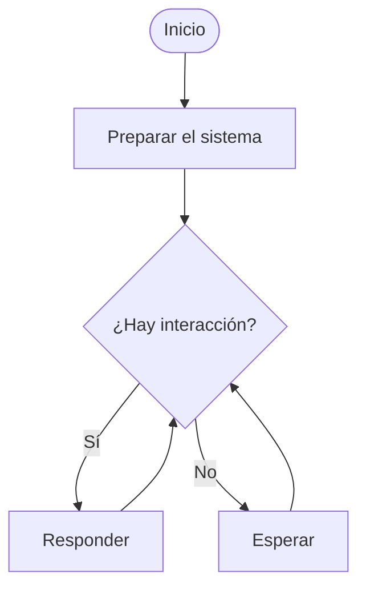

# nombre-del-proyecto

Una línea que sintetiza qué es el proyecto y para quién: artefacto o interfaz + usuario + situación de uso. Máximo dos líneas.


## Acerca del proyecto

- **Grupo XX**
- Curso: Taller 4: Problema y concepto, DIS09221_C07, 2026-2
- Docentes: Carolina Pino y Felipe Roa
- Ayudante: Santiago Gaete
- Tema asignado: tema
- Lugar asignado: lugar

### Integrantes

| Nombre | GitHub | Rol |
| :--- | :--- | :--- |
| Nombre Apellido | [usuario-github](https://github.com/usuario-github) | investigación |
| Nombre Apellido | [usuario-github](https://github.com/usuario-github) | código y electrónica |
| Nombre Apellido | [usuario-github](https://github.com/usuario-github) | diseño gráfico |
| Nombre Apellido | [usuario-github](https://github.com/usuario-github) | prototipo |

### Entregables

- [Video](https://youtube.com/)
- [Ficha tabloide](./entregables/ficha-tabloide.pdf)
- [Código](./entregables/codigo/)

## Resumen

Dos o tres líneas por cada punto.

- **Problema**: qué problema u oportunidad abordamos.
- **Metodología**: cómo investigamos, prototipamos y probamos.
- **Resultado**: qué hicimos.
- **Conclusiones**: qué aprendimos.

## Concepto

**Concepto aplicado**: el concepto que hila todo el proyecto y cómo se ve en sus decisiones.

### Descripción

Qué es el proyecto y qué experiencia propone.

### Implementación

Cómo se usa, paso a paso, desde que la persona lo ve hasta que se va.

- **Input**: qué recibe.
- **Procesamiento**: qué decide.
- **Output**: cómo responde.

### Fundamentación

Qué nos motivó y por qué es relevante.

### Persona Usuaria Objetivo

Quién lo usa y en qué situación.

## Contexto y problema

### Trabajo de campo

Cuándo fuimos al lugar asignado, qué observamos, con quiénes hablamos y qué encontramos.


### Problema u oportunidad

Problemática identificada en un párrafo: qué pasa, dónde, a quién afecta y qué evidencia lo demuestra.

### Objetivos

Qué busca lograr el proyecto, en uno a tres puntos.

### Objetivos de Desarrollo Sostenible

- **[ODS X: nombre](https://www.un.org/sustainabledevelopment/es/sustainable-development-goals/)**. Relación con el proyecto.
- **[ODS X: nombre](https://www.un.org/sustainabledevelopment/es/sustainable-development-goals/)**. Relación con el proyecto.

## Sistema

### Esquema general

Actores, componentes y relaciones, igual que en la ficha tabloide.


### Esquema electrónico (si aplica)


### Bill of materials

Incluir también los materiales de fabricación y los equipos, como computador, cámara o proyector.

| Componente | Valor o modelo | Cantidad | Precio unitario | Subtotal | Link de compra |
| :--- | :--- | :---: | ---: | ---: | :--- |
| ESP32 | modelo | 1 | $0 | $0 | https:// |
| Componente | modelo | 1 | $0 | $0 | https:// |
| Componente | modelo | 1 | $0 | $0 | https:// |
| **Total** | | | | **$0** | |

## Software

### Qué corre dónde

Dejar solo las filas que correspondan.

| Parte | Dónde corre | Lenguaje o herramienta | Archivo |
| :--- | :--- | :--- | :--- |
| Sensores y actuadores | ESP32 | Arduino (C++) | [proyecto.ino](./codigo/proyecto/proyecto.ino) |
| Reconocimiento de imagen | computador | Python | [main.py](./codigo/main.py) |
| Interfaz | navegador | HTML, CSS, JS | [index.html](./codigo/index.html) |

### Dependencias

| Librería o programa | Versión | Para qué se usa |
| --- | --- | --- |
| ... | ... | ... |

### Instalación y ejecución

Los pasos para que alguien que no conoce el proyecto lo pueda hacer funcionar.

1. Instalar ...
2. Conectar ...
3. Ejecutar ...

### Diagrama de flujo



### Explicación del código

Elegir los 3 bloques más importantes. No pegar el código completo.

<!-- junto a las comillas, cambiar txt por el lenguaje: cpp, python, js, etc. -->

#### Bloque 1

```txt
fragmento de código
```

Qué hace y por qué está hecho así.

#### Bloque 2

```txt
fragmento de código
```

Qué hace y por qué está hecho así.

#### Bloque 3

```txt
fragmento de código
```

Qué hace y por qué está hecho así.

## Proceso

### Etapa inicial

Primeras ideas, lo que se descartó y por qué.

### Imágenes

|  |  |  |
| - | - | - |
|  |  |  |
|  |  |  |

## Resultado

Qué logramos y cómo responde al problema y al concepto.

| | |
| - | - |
|  |  |
|  |  |

[](https://youtube.com/)

## Conclusiones

### Distancia entre premisa y resultado

En qué se parece y en qué se aleja el resultado de lo que planteamos al inicio.

### Cosas no conseguidas

Qué no se logró y por qué.

### Descubrimientos al trabajar

Qué aprendimos y qué haríamos a continuación.

## Uso de IA

Declarar todo uso de IA. El grupo debe poder explicar cada línea del código que entrega.

| IA | Licencia | Problema a resolver | Qué usamos o descartamos |
| :--- | :--- | :--- | :--- |
| nombre | gratuita / pagada | ... | ... |

### Prompts utilizados

#### Prompt 1

> acá va el prompt

### Código entregado por IA

- [archivo](./codigo/): qué líneas o funciones entregó la IA y qué les modificamos.

## Referentes y bibliografía

Citar también dentro del texto: (Apellido, año).

### Referentes

#### Nombre del referente

Apellido, N. (año). *Título de la obra o proyecto*. Medio, lugar. <https://enlace.cl>

Qué tomamos de este referente y en qué nos diferenciamos.


### Bibliografía

- Apellido, N. (año). *Título del texto*. Editorial.
