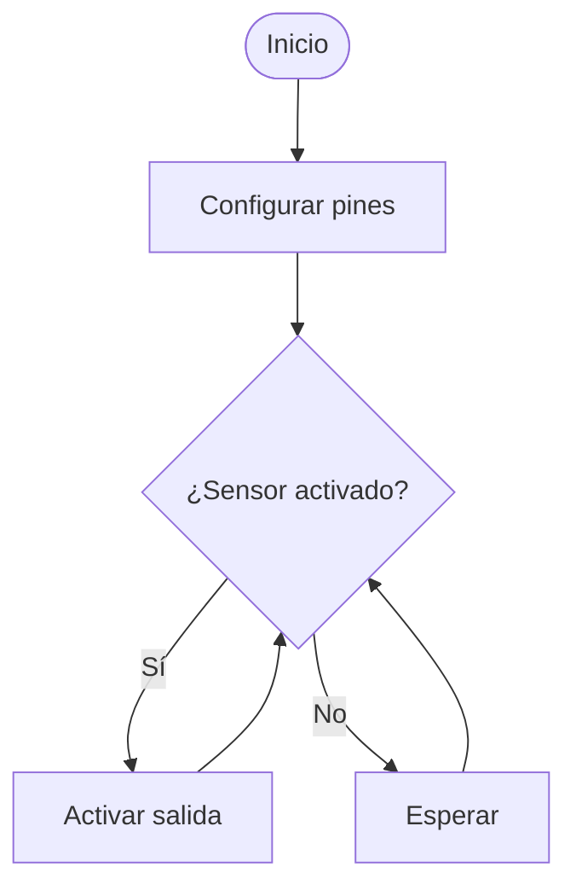

# nombre-del-proyecto

## Acerca del proyecto

- Grupo XX: nombre del grupo

- Integrantes:
  - Nombre Apellido / [usuario-github](https://github.com/usuario-github)
  - Nombre Apellido / [usuario-github](https://github.com/usuario-github)
  - Nombre Apellido / [usuario-github](https://github.com/usuario-github)

## Licencia

Esta obra y su documentación están bajo una [Licencia Creative Commons Atribución-CompartirIgual 4.0 Internacional](https://creativecommons.org/licenses/by-sa/4.0/).

© 2026 [Nombre Apellido, Nombre Apellido, Nombre Apellido]

## Concepto

Qué es el proyecto, qué problema aborda, para quién es y qué experiencia propone.

## Bill of materials

| Componente | Cantidad | Link de compra |
| :--- | :---: | ---: |
| Arduino UNO R4 WiFi | 1 | https:// |
| Componente | 1 | https:// |
| Componente | 1 | https:// |

### Nombre del componente principal

Por qué elegimos este componente y qué rol cumple en el proyecto.


> Directamente desde [tienda](https://)

#### Características

- **Voltaje de funcionamiento** 5V

- **Interfaz** digital / analógica / I2C

- **Otra característica** ...

## Código

### Diagrama de flujo



### Esquema


## Proceso

### Referentes

Proyectos o ejemplos que inspiraron el trabajo y qué tomamos de cada uno.


### Imágenes

|  |  |  |
|- | - | - |
|  |  |  |
|  |  |  |

### Etapa inicial

Primeras ideas, lo que se descartó y por qué.

### Pseudo código

#### **Listado de pasos**

1. Inicia el Arduino.
2. ...
3. ...

##### Situaciones que podrían entrar en conflicto

- ...

#### Estados de la máquina

1. **Estado 1**: qué ocurre.
2. **Estado 2**: qué ocurre.

#### Variables y arreglos

```cpp
// pines, variables y arreglos
```

##### Funciones

- `nombreFuncion()`: qué hace.

### Pruebas

#### Prueba 01

Qué se probó, qué funcionó y qué falló.

```cpp
// código de la prueba
```

[](https://youtube.com/)

#### Prueba 02

...

#### Resultado

Código final del proyecto.

```cpp
// código final
```

[](https://youtube.com/)


## Uso de IA

Conversaciones con IA usadas en el proyecto, en PDF:

- [nombre-conversacion.pdf](./pdfs-ia/nombre-conversacion.pdf)


## Bibliografía

- ...
